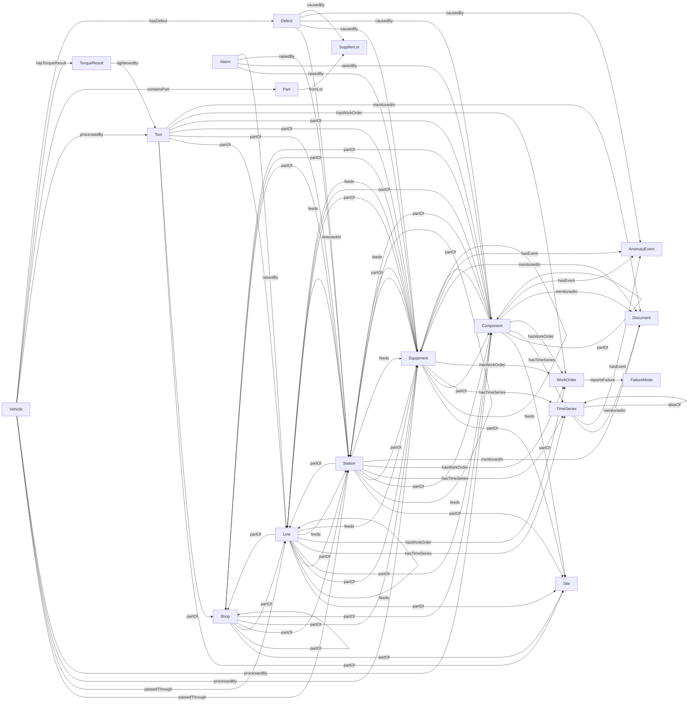

# Ontology v1.1.0

Generated by `python -m ddn.ontology` from `ontology/ontology_v1.yaml`. Do not edit by hand.

**Storage:** Neo4j 5 Community (property graph, Cypher); time series in Parquet files partitioned by tag and day (graph holds only a pointer).

*Why a property graph:* The questions in Part D are path traversals with time filters (VIN -> station -> equipment -> signal window). A property graph keeps relationship properties (time, confidence, provenance) directly on the edge; RDF needs reification or RDF-star for the same thing. Cypher is also the language an LLM writes most reliably for Part E2.

## Diagram



## Node types

| Node | ISA-95 level | Cognite view | Key | Properties (* = required) | Example |
|---|---|---|---|---|---|
| **Site** | Enterprise/Site | CogniteAsset | `fl` | fl*, name* | `DDN1` |
| **Shop** | Area | CogniteAsset | `fl` | fl*, name*, code* | `DDN1-BIW` |
| **Line** | Production line / process cell | CogniteAsset | `fl` | fl*, name*, code* | `DDN1-BIW-L2` |
| **Station** | Work cell / work unit | CogniteAsset | `fl` | fl*, name*, mes_code, rfid_reader, sequence | `DDN1-BIW-L2-ST04 (mes_code B2-04)` |
| **Equipment** | Equipment | CogniteEquipment | `fl` | fl*, name*, asset_type*, iso14224_class, sap_equipment_no, manufacturer, model, install_date, criticality, aliases | `DDN1-BIW-L2-ST04-RB07` |
| **Component** | Equipment module | CogniteEquipment | `fl` | fl*, name*, asset_type*, sap_equipment_no, aliases | `DDN1-BIW-L2-ST04-RB07-WG` |
| **Tool** | Equipment (personnel-held or controller channel) | CogniteEquipment | `tool_id` | tool_id*, kind*, calibration_due | `TC14` |
| **TimeSeries** | n/a | CogniteTimeSeries | `tag` | tag*, source_system*, description, unit, unit_canonical, isa51_code, signal, store_uri, latest_value, latest_at | `DDN1_BIW_L2_R07_WELDCUR.PV` |
| **WorkOrder** | Maintenance work request | CogniteActivity (extended) | `wo_number` | wo_number*, wo_type*, priority, created_at*, closed_at, short_text*, long_text, technician | `4102961` |
| **FailureMode** | n/a | none (custom view) | `code` | code*, name*, standard* | `LOO (low output)` |
| **Document** | n/a | CogniteFile | `doc_id` | doc_id*, title*, kind*, revision, path*, ocr | `DWG-PNT-SL-201` |
| **Alarm** | Event | CogniteActivity | `event_id` | event_id*, event_time*, event_type*, code, message, priority, duration_s, source_raw*, is_duplicate | `EV900708` |
| **AnomalyEvent** | Event | CogniteActivity | `anomaly_id` | anomaly_id*, start*, end*, detector*, score, kind, judged | `AN-0001` |
| **Vehicle** | Material lot (serialised product) | CogniteDescribable (custom view) | `vin` | vin*, model_code*, model_desc, color, body_start_at* | `MDDA5XL04D000101` |
| **Part** | Material sublot (fitted part) | CogniteDescribable (custom view) | `part_uid` | part_uid*, part_no*, part_desc, supplier | `MDDA5XL04D000101|DOOR_SEAL` |
| **SupplierLot** | Material lot | CogniteDescribable (custom view) | `lot_id` | lot_id*, supplier*, part_no*, produced_from, produced_to | `WS-260904-B` |
| **TorqueResult** | Process segment result | CogniteDescribable (custom view) | `result_id` | result_id*, joint_id*, program, torque_nm*, angle_deg, torque_min*, torque_max*, status*, attempt*, timestamp* | `5000001` |
| **Defect** | Quality test result | CogniteDescribable (custom view) | `defect_id` | defect_id*, detected_at*, defect_code*, defect_family, defect_desc, location, severity*, inspector_remark | `D700004` |

## Edge types

| Edge | From | To | Card. | Time-valid | Extra properties | Meaning |
|---|---|---|---|---|---|---|
| **partOf** | Shop, Line, Station, Equipment, Component, Tool | Site, Shop, Line, Station, Equipment, Component | one | yes | — | ISA-95 containment. Time-bounded so a relocated robot keeps its history. |
| **hasTimeSeries** | Equipment, Component, Station, Line | TimeSeries | many |  | — | Output of the tag matcher (Part C). |
| **hasWorkOrder** | Equipment, Component, Station, Line, Tool | WorkOrder | many |  | — | Output of the work-order matcher (Part C4). |
| **reportsFailure** | WorkOrder | FailureMode | many |  | — | Failure mode extracted from text or failure_code and mapped to ISO 14224. |
| **mentionedIn** | Equipment, Component, Station, TimeSeries, Tool | Document | many |  | page, label | Tag or label found in a drawing or manual (Part C5), with page number. |
| **feeds** | Station, Equipment, Line | Station, Equipment, Line | many |  | relation | Upstream -> downstream. Used by query D4 to walk back from an inspection point. |
| **passedThrough** | Vehicle | Station, Line | many |  | passed_at, reader_id, inferred | RFID passage. Missed reads are filled from line order + takt and flagged inferred=true. |
| **processedBy** | Vehicle | Equipment, Component, Tool | many |  | start, end | Derived from passedThrough + which equipment was partOf the station at that time. Only materialised for equipment that touches the car; for the rest it is computed at query time. |
| **containsPart** | Vehicle | Part | many |  | fitted_at, fitted_station |  |
| **fromLot** | Part | SupplierLot | one |  | — |  |
| **hasTorqueResult** | Vehicle | TorqueResult | many |  | — |  |
| **tightenedBy** | TorqueResult | Tool | one |  | — |  |
| **hasDefect** | Vehicle | Defect | many |  | — |  |
| **detectedAt** | Defect | Station | one |  | — | Inspection point where the defect was found (never the cause). |
| **causedBy** | Defect | Equipment, Component, AnomalyEvent, SupplierLot | many |  | — | Root-cause hypothesis; always method=derived or engineer, never source_key. |
| **raisedBy** | Alarm | Equipment, Component, Station, Line | one |  | — | Alarm source path normalised and matched to an asset. |
| **hasEvent** | Equipment, Component, TimeSeries | AnomalyEvent | many |  | — | Written by Part E1. |
| **aliasOf** | TimeSeries | TimeSeries | one |  | — | Legacy tag name pointing at its current equivalent (relocated robot). |

## Provenance (on every edge)

| Property | Type | Values |
|---|---|---|
| `source_system` | enum (required) | SAP_PM, PI, WinCC, S7_OPC, MES, TOOL_CTRL, QMS, ALARMS, DOCUMENTS, PIPELINE, ENGINEER |
| `method` | enum (required) | source_key, rule, fuzzy, ml, engineer, inferred, derived |
| `confidence` | float (required) | 0.0–1.0 |
| `created_at` | datetime (required) |  |
| `status` | enum (required) | approved, suggested, rejected |
| `evidence` | string |  |
| `model_version` | string |  |

## Containers and views (Cognite mapping)

In Neo4j a container is a node label plus its property set and constraints (a uniqueness constraint on the key, plus range indexes on the time properties used in queries).

| View | Audience | Node types | Edges |
|---|---|---|---|
| Maintenance | Maintenance engineer | Equipment, WorkOrder, FailureMode, TimeSeries, Alarm | partOf, hasWorkOrder, reportsFailure, hasTimeSeries, raisedBy, hasEvent |
| Quality | Quality engineer | Vehicle, Defect, Station, Equipment, AnomalyEvent | hasDefect, detectedAt, passedThrough, processedBy, feeds, causedBy, hasEvent |
| Traceability | Recall / supplier quality | Vehicle, Part, SupplierLot, TorqueResult, Tool | containsPart, fromLot, hasTorqueResult, tightenedBy, passedThrough |

## Time validity

Edges flagged time_valid carry valid_from and valid_to (null = still valid). Example: DDN1-BIW-L2-ST06-RB12 partOf DDN1-BIW-L1-ST03 until 2026-03-01, then partOf DDN1-BIW-L2-ST06. A VIN query joins on passed_at BETWEEN valid_from AND coalesce(valid_to, now()), so VINs built before and after the move get the right robot.

## Keeping it fast

- This pack: 7,200 VINs x ~44 stations = ~310k passedThrough edges, plus ~80k torque and ~65k part edges
- Assignment scale: 18,000 VINs x 40 stations = 720k passedThrough edges per month
- VINs link to Stations (46 nodes), not to every piece of equipment; processedBy is materialised only for equipment that touches the car.
- Range indexes on passed_at/start so time-window queries do not scan all edges.
- Bulk load with UNWIND batches of 10k rows (or neo4j-admin import for the first load).
- Time series values never enter the graph; only latest_value is cached on the node.
- Beyond one plant, partition by plant (one database per site, or a :Site label in every key).

## Schema as the LLM will see it

```
Node labels (key property first):
  (:Site {fl, name})
  (:Shop {fl, name, code})
  (:Line {fl, name, code})
  (:Station {fl, name, mes_code, rfid_reader, sequence})
  (:Equipment {fl, name, asset_type, iso14224_class, sap_equipment_no, manufacturer, model, install_date, criticality, aliases})
  (:Component {fl, name, asset_type, sap_equipment_no, aliases})
  (:Tool {tool_id, kind, calibration_due})
  (:TimeSeries {tag, source_system, description, unit, unit_canonical, isa51_code, signal, store_uri, latest_value, latest_at})
  (:WorkOrder {wo_number, wo_type, priority, created_at, closed_at, short_text, long_text, technician})
  (:FailureMode {code, name, standard})
  (:Document {doc_id, title, kind, revision, path, ocr})
  (:Alarm {event_id, event_time, event_type, code, message, priority, duration_s, source_raw, is_duplicate})
  (:AnomalyEvent {anomaly_id, start, end, detector, score, kind, judged})
  (:Vehicle {vin, model_code, model_desc, color, body_start_at})
  (:Part {part_uid, part_no, part_desc, supplier})
  (:SupplierLot {lot_id, supplier, part_no, produced_from, produced_to})
  (:TorqueResult {result_id, joint_id, program, torque_nm, angle_deg, torque_min, torque_max, status, attempt, timestamp})
  (:Defect {defect_id, detected_at, defect_code, defect_family, defect_desc, location, severity, inspector_remark})
Relationships (every one also has source_system, method, confidence, created_at, status):
  (Shop|Line|Station|Equipment|Component|Tool)-[:partOf {valid_from, valid_to}]->(Site|Shop|Line|Station|Equipment|Component)
  (Equipment|Component|Station|Line)-[:hasTimeSeries]->(TimeSeries)
  (Equipment|Component|Station|Line|Tool)-[:hasWorkOrder]->(WorkOrder)
  (WorkOrder)-[:reportsFailure]->(FailureMode)
  (Equipment|Component|Station|TimeSeries|Tool)-[:mentionedIn {page, label}]->(Document)
  (Station|Equipment|Line)-[:feeds {relation}]->(Station|Equipment|Line)
  (Vehicle)-[:passedThrough {passed_at, reader_id, inferred}]->(Station|Line)
  (Vehicle)-[:processedBy {start, end}]->(Equipment|Component|Tool)
  (Vehicle)-[:containsPart {fitted_at, fitted_station}]->(Part)
  (Part)-[:fromLot]->(SupplierLot)
  (Vehicle)-[:hasTorqueResult]->(TorqueResult)
  (TorqueResult)-[:tightenedBy]->(Tool)
  (Vehicle)-[:hasDefect]->(Defect)
  (Defect)-[:detectedAt]->(Station)
  (Defect)-[:causedBy]->(Equipment|Component|AnomalyEvent|SupplierLot)
  (Alarm)-[:raisedBy]->(Equipment|Component|Station|Line)
  (Equipment|Component|TimeSeries)-[:hasEvent]->(AnomalyEvent)
  (TimeSeries)-[:aliasOf]->(TimeSeries)
```
