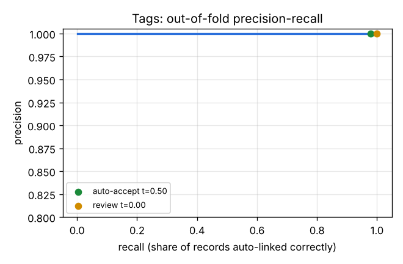
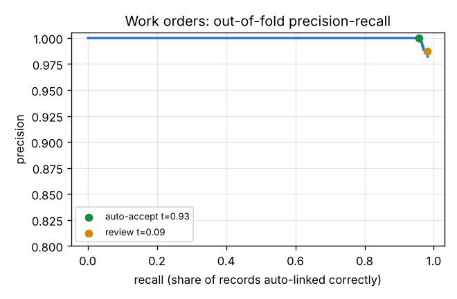

**Result in one paragraph.** A Python pipeline links the siloed records of plant DDN-01 to one asset
hierarchy and loads them into a Neo4j knowledge graph with provenance on every edge. It runs end to end with
one command (`run_all.bat` on Windows, `make all` elsewhere; 17 steps, 99 tests). Tags are matched with
**F1 1.000** and work orders with **F1 0.982** (out-of-fold on the TRAIN labels; the hidden test set is the
real measure), with **0 wrong auto-accepted links**. The graph holds 165,706 nodes and 1.14 M relationships,
answers the 7 required queries, contains 8 anomaly events (all 8 seeded signal problems found, 1 judged a
false alarm), and supports a GraphRAG question box that scored **5/5 on unseen questions** and never
stated a wrong fact in any run. All data is the synthetic DDN-01 pack.

# 1. Part A – How industrial platforms do contextualization

Compared: **Cognite Data Fusion (CDF)**, **Siemens** (Insights Hub, Industrial Information Hub, Industrial
Copilot) and **AWS IoT TwinMaker**, from vendor documentation. The full version with every link is
`docs/part_a_research.md`.

Source status: the vendor sites could not be opened from the build environment, so these
claims were compiled from search extracts of the linked official pages. Each link is to be opened and checked
before submission; claims marked ⚠ were not confirmed on an official page.

**How the plant is modelled.** CDF's *Data Modeling Service* separates **containers** (physical storage of
properties), **views** (logical schemas over containers, which can rename, combine and inherit) and **data
models** (groups of views), all scoped to a *space*
([Cognite: containers, views, data models](https://docs.cognite.com/cdf/dm/dm_concepts/dm_containers_views_datamodels)).
Cognite ships a **Core Data Model** (`cdf_cdm`) with `CogniteAsset`, `CogniteEquipment`, `CogniteTimeSeries`,
`CogniteFile`, `CogniteActivity`; `CogniteAsset` carries parent, root and an automatic path
([Core data model](https://docs.cognite.com/cdf/dm/dm_reference/dm_core_data_model)). Siemens **Insights Hub**
builds *asset types* from *variables* and *aspects*, inherited from the parent type
([Asset Management](https://developer.siemens.com/insights-hub/docs/apis/advanced-assetmanagement/api-assetmanagement-overview.html));
**IIH Semantics** exposes models and time series through a GraphQL API backed by a knowledge graph
([IIH](https://developer.siemens.com/industrial-information-hub/overview.html)). AAS support is a separate
product, **SITRANS assetfox** ([assetfox](https://www.siemens.com/en-us/products/sitrans/assetfox/)) ⚠ (none found
inside Insights Hub). In **TwinMaker**, twins are *entities* with *components*; relationship properties become
edges of its knowledge graph and parent links add `isChildOf`
([TwinMaker knowledge graph](https://docs.aws.amazon.com/iot-twinmaker/latest/guide/tm-knowledge-graph.html)).

**How records are linked.**

| Method | Cognite | Siemens | AWS |
|---|---|---|---|
| Rules | Regex rules and confirmed matches are applied **before** model predictions ([matching](https://docs.cognite.com/cdf/integration/guides/contextualization/matching)) | Configuration in the asset model and connectors ⚠ | Declared on components |
| Fuzzy / ML | Unsupervised field-similarity model by default; **supervised** when `trueMatches` labels exist ([entity matching API](https://docs.cognite.com/api-reference/concepts/20230101/entity-matching)) | No documented ML matcher ⚠ | None built in |
| Diagrams | Tags, symbols and connections from P&IDs; raster gives tags only ([diagram parsing](https://docs.cognite.com/cdf/integration/guides/contextualization/diagram_parsing)) | – | – |
| Review | Quick match, pipelines, manual confirmation ([match entities](https://docs.cognite.com/cdf/integration/guides/contextualization/match_entities/)) | – | – |

**How confidence is handled.** Cognite is the most explicit. A pipeline uses a model match only above a score
threshold and only if it is not in the rejected list; confirmed matches take priority and `refit` retrains on
them ([matching](https://docs.cognite.com/cdf/integration/guides/contextualization/matching),
[SDK](https://cognite-sdk-python.readthedocs-hosted.com/en/latest/contextualization.html)). `CogniteAnnotation`
has a `confidence` and a `status` of *Suggested / Approved / Rejected*
([core model](https://docs.cognite.com/cdf/dm/dm_reference/dm_core_data_model)). No equivalent predicted-link
workflow was found for Siemens or AWS ⚠: their links are configured, not predicted.

**Standards.** ISA-95 hierarchies appear in all three (`CogniteAsset` path
([hierarchy guide](https://docs.cognite.com/cdf/dm/dm_guides/dm_cdm_build_asset_hierarchy)), Insights Hub
asset tree, TwinMaker `isChildOf`). Siemens Rapidminer **Graph Studio** uses W3C ontologies
([Graph Studio](https://www.siemens.com/en-us/products/rapidminer/graph-studio/)); Cognite and AWS use their own
property-graph models. Cognite binds units from a catalog at container level
([units](https://docs.cognite.com/dev/concepts/resource_types/units/units)). OPC UA ingestion is via
extractors (Cognite) ⚠, native (Siemens), and SiteWise (AWS) ⚠.

**How GenAI uses the graph.** **Cognite Atlas AI** agents call tools such as "query knowledge graph", document
Q&A and time-series analysis; they require the Core Data Model and are separately licensed
([Atlas AI](https://docs.cognite.com/cdf/atlas_ai/concepts),
[agent tools](https://docs.cognite.com/cdf/atlas_ai/references/atlas_ai_agent_tools)). **Siemens Industrial
Copilot** (with Microsoft, Azure OpenAI) generates automation code and helps diagnose faults; Schaeffler uses it
on the shop floor
([Siemens press](https://press.siemens.com/global/en/pressrelease/ai-industry-schaeffler-and-siemens-bring-industrial-copilot-shopfloor)).
Its grounding is engineering data more than a plant graph ⚠. **TwinMaker** queries its graph with PartiQL
`MATCH`, including variable-length paths, which an agent can call as a tool
([queries](https://docs.aws.amazon.com/iot-twinmaker/latest/guide/tm-knowledge-graph-use.html)).

**Values vs metadata.** All three keep raw values out of the graph. A `CogniteTimeSeries` is a node, but its
datapoints go through the time-series API
([time series in DM](https://docs.cognite.com/cdf/dm/dm_guides/dm_integrate_with_time_series)). Siemens stores
records per asset + aspect in the IoT Time Series service
([IoT Time Series](https://developer.siemens.com/insights-hub/docs/apis/iot-iottimeseries/api-iottimeseries-overview.html)).
TwinMaker components point at SiteWise or Timestream through connectors.

**Limits.**

| | Cognite | Siemens | AWS |
|---|---|---|---|
| Lock-in | Proprietary DMS schema; migration means re-modelling | Tied to the Siemens automation stack | Tied to SiteWise / Timestream |
| Cost | Atlas AI licensed separately | Subscription | Knowledge graph charged per query ([pricing](https://aws.amazon.com/iot-twinmaker/pricing/)) |
| Operations | A changed container means a new container and re-ingest | Ingest throttled per asset/aspect | – |
| Still needs people | Confirming matches, writing rules, fixing tag misreads ([troubleshooting](https://docs.cognite.com/cdf/integration/guides/contextualization/troubleshooting/)) | Building types and aspects | Declaring every relationship |

**Automotive use cases.** Siemens: Schaeffler (link above, press release). AWS: Volkswagen Digital Production
Platform, 43 sites, GenAI maintenance assistant
([AWS case study](https://aws.amazon.com/solutions/case-studies/volkswagen-dpp-generativeai/)); it does not
state that TwinMaker is used. Cognite: no named automotive OEM case found ⚠; closest is Aarbakke, machining
with welding robots ([case](https://www.cognite.com/en/customers/aarbakke)).

**Ideas borrowed for Parts C and D.** From **Cognite**: rules and engineer-confirmed matches before the ML
model; a score threshold plus a remembered rejected list; `confidence` + `status` (suggested / approved /
rejected) on every link; confirmed links reused as training labels (`refit`); and the **container / view**
split, mirrored as one storage schema with role-specific views in the ontology file. From **Siemens**:
equipment *types* that define which signals a type should have, used as the "unit fits equipment type" feature.
From **AWS**: variable-length path patterns for the `feeds` traversal (query D4). From all three: values stay
outside the graph, which holds only pointers.

# 2. Part B – What the data pack contains

14 files were profiled (`reports/01`, `notebooks/01_data_profiling.ipynb`): 455 assets, 1,541 tags in four
naming conventions, 1.1 M one-minute values for 55 tags, 7,200 VINs with 310,462 RFID passages, 79,855 torque
results, 64,800 part-lot records, 675 defects, 2,968 work orders and 7,917 alarms.

**Data quality.** 38 issues, each with a count and verifiable examples (`reports/02`); **15 are not in the
data dictionary**. Examples: 18 assets with a missing parent, a relocated robot whose tag keeps the old name,
°F and °C in the same historian, a stuck sensor, 815 alarms writing `S3` for station `ST03`, SAP failure codes
that contradict the work-order text, and a supplier lot id reused across two fitting sessions.

**Identity schemes.** The canonical key is the SAP **functional location** (`DDN1-BIW-L2-ST04-RB07`). The
same robot is `DDN1_BIW_L2_R07_WELDCUR.PV` in PI, `RB-207` on the drawing, `B2-04` in MES and "R7" or "robo
7" in Hinglish work orders (`reports/03`). Defects are logged against VIN and inspection point, never against
equipment, so only the graph can connect a defect to a machine.

**Production problems found** (`reports/04`; method: anomaly window → VINs exposed at that equipment → defect
rate vs. all other VINs):

| # | Problem | Exposed VINs | Defective exposed / not | Lift |
|---:|---|---:|---|---:|
| 1 | Press line 1 die set-up error → split body-side panels | 300 | 28 / 0 | all |
| 2 | Nutrunner NR14 transducer offset → low wheel-nut torque | 37 | 37 / 0 | all |
| 3 | Robot L2 R07 weld-current drift → cold welds | 634 | 101 / 6 | 174× |
| 4 | Door-seal lot WS-260904-B → water leaks (lot id reused) | 1,492 | 85 / 0 | all |
| 5 | Sealer SR03 heater failure → roof-ditch leaks | 106 | 36 / 1 | 2,409× |
| 6 | Booth B humidifier valve stuck open → paint craters | 29 | 7 / 0 | all |
| 7 | Oven 2 zone 3 over-temperature (no defects: false alarm) | 19 | 0 / 81 | 0× |
| 8 | AHU TC1 supply-fan bearing wear (caught before failure) | – | – | – |
| 9 | E-coat TT-301 transmitter frozen (sensor fault) | – | – | – |

# 3. Design decisions

<svg viewBox="0 0 960 250" xmlns="http://www.w3.org/2000/svg" font-family="Helvetica, Arial" font-size="12">
<defs><marker id="a" viewBox="0 0 10 10" refX="9" refY="5" markerWidth="7" markerHeight="7" orient="auto"><path d="M0,0L10,5L0,10z" fill="#445"/></marker></defs>
<g fill="#eef3f8" stroke="#1f4e79">
<rect x="5" y="20" width="135" height="210" rx="6"/>
<rect x="170" y="20" width="120" height="90" rx="6"/>
<rect x="320" y="20" width="160" height="90" rx="6"/>
<rect x="510" y="20" width="120" height="40" rx="6"/>
<rect x="510" y="70" width="120" height="40" rx="6"/>
<rect x="170" y="140" width="310" height="90" rx="6"/>
<rect x="660" y="20" width="140" height="210" rx="6" fill="#dfe9f4"/>
<rect x="830" y="20" width="125" height="60" rx="6"/>
<rect x="830" y="95" width="125" height="60" rx="6"/>
<rect x="830" y="170" width="125" height="60" rx="6"/>
</g>
<g fill="#123">
<text x="15" y="40" font-weight="bold">Sources (raw)</text>
<text x="15" y="62">SAP PM assets</text><text x="15" y="80">Historian tags (4 styles)</text>
<text x="15" y="98">Time series 1 min</text><text x="15" y="116">MES / RFID / torque</text>
<text x="15" y="134">Part lots, defects</text><text x="15" y="152">Work orders (Hinglish)</text>
<text x="15" y="170">Alarms / andon</text><text x="15" y="188">Drawings (1 scanned)</text>
<text x="15" y="206">Manuals</text>
<text x="180" y="40" font-weight="bold">C1 Staging</text>
<text x="180" y="60">pydantic, Parquet</text><text x="180" y="78">parse tags, °F→°C</text><text x="180" y="96">ISA-5.1 codes</text>
<text x="330" y="40" font-weight="bold">C2–C3 Matching</text>
<text x="330" y="60">TF-IDF + token blocking</text><text x="330" y="78">rules + 20 pair features</text><text x="330" y="96">LightGBM, out-of-fold</text>
<text x="520" y="45">auto-accept</text><text x="520" y="95">review (Streamlit)</text>
<text x="180" y="160" font-weight="bold">C4–C6 Text, documents, VINs</text>
<text x="180" y="180">spaCy EntityRuler → ISO 14224 failure modes</text>
<text x="180" y="198">PyMuPDF / Tesseract → mentionedIn (page)</text>
<text x="180" y="216">MES passages, missed reads inferred (flagged)</text>
<text x="670" y="40" font-weight="bold">D Knowledge graph</text>
<text x="670" y="62">Neo4j 5 (Docker)</text><text x="670" y="80">ontology v1.3 (YAML)</text>
<text x="670" y="98">provenance on</text><text x="670" y="114">every edge</text>
<text x="670" y="134">time-valid partOf</text><text x="670" y="156">values: Parquet,</text>
<text x="670" y="172">store_uri pointer</text><text x="670" y="194">165,706 nodes</text><text x="670" y="210">1.14 M edges</text>
<text x="840" y="42" font-weight="bold">E1 anomalies</text><text x="840" y="62">events → VINs</text>
<text x="840" y="117" font-weight="bold">E2 GraphRAG</text><text x="840" y="137">cited answers</text>
<text x="840" y="192" font-weight="bold">Queries D1–D7</text><text x="840" y="212">Cypher</text>
</g>
<g stroke="#445" fill="none" marker-end="url(#a)">
<path d="M140,65H168"/><path d="M290,65H318"/><path d="M480,40H508"/><path d="M480,90H508"/>
<path d="M630,40H658"/><path d="M630,90H658" stroke-dasharray="4 3"/><path d="M140,185H168"/><path d="M480,185H658"/>
<path d="M800,50H828"/><path d="M800,125H828"/><path d="M800,200H828"/>
</g>
<text x="636" y="108" font-size="10" fill="#445">approved</text>
</svg>

Figure 1. Pipeline as built. Only auto-accepted or engineer-approved links enter the graph.

**Canonical key: the SAP functional location.** It is the only identifier every engineer recognises, it encodes
the ISA-95 path (site–shop–line–station–equipment–component), and it survives renaming in the historian.
Every other identifier (tag, MES station, drawing label, alias in work-order text) becomes either a property
(`aliases`, `mes_code`) or a linked node.

**Matching (Part C).** Comparing every record with every asset (1,541 × 455) is wasteful and gets worse at
scale, so **blocking** keeps the top-15 assets by character n-gram TF-IDF plus a token index on equipment
codes. That is ~25 candidates per record instead of 375, with blocking recall 1.000 (tags) and 0.999 (work
orders). A rules matcher (exact code, alias, relocation, SAP equipment number) is kept as a baseline *and* as a
feature. For each pair, 20 features (rule agreement, fuzzy name/FL scores, line and component conflicts, unit
fits equipment type, SAP equipment number agrees with the text, valid at the record's time) feed **LightGBM**.
Scores are **out-of-fold** with GroupKFold by record, so no record is scored by a model that saw its label.

**Thresholds by cost, not by F1.** In a recall investigation, a wrong auto-accepted link sends engineers to
the wrong machine, which is worse than a link waiting for review. The auto-accept threshold is therefore
the lowest score on the out-of-fold precision curve with **precision ≥ 0.995 and no wrong-machine error**
(0.932 for work orders, 0.50 for tags). Below it, links go to the **Streamlit review screen**. Each decision is
stored in `data/review/decisions.csv`, becomes an `method=engineer` edge, and is reused as a training label on
the next run. Anomaly-explaining work orders are shown first.

**Text and documents.** Work orders: a Hinglish normaliser ("robo", "nahi chal raha"), then a spaCy
EntityRuler for equipment mentions and a phrase dictionary for **ISO 14224** failure modes (`STD`, `ERO`,
`FTS`, …). Drawings: PyMuPDF text layer, or **Tesseract OCR** for the scanned press-line drawing. OCR
confidence is lower (0.85, or 0.70 after a correction, which goes to review). Labels like `RB-207` are resolved
with the drawing's own line context.

**VIN traceability.** MES stations are mapped to FLs (46/46). Missed RFID reads (6,332, 2%) are filled from
line sequence and takt time (2.4 min) and flagged `inferred=true`. The inference was validated by hiding 5,793
real reads: the median error is 0.28 min, and 95.7% are within one takt. The large errors sit right after
buffers, so each inferred passage stores `uncertainty_min` and gets a lower confidence.

**Ontology first; property graph.** `ontology/ontology_v1.yaml` (v1.3.0, 18 node types, 19 edge types) is the
single source of truth. It is validated with pydantic, rendered to `docs/ontology.md`, and used both by the loader
(which rejects edges whose endpoints the ontology forbids) and by GraphRAG (the schema the LLM sees). Following
Cognite, it separates **containers** (what is stored: labels + properties + indexes) from **views**
(Maintenance, Quality, Traceability: what each role sees). I chose a **property graph (Neo4j Community + Cypher)**
over RDF. The questions are path questions with properties on the edges (time, confidence, provenance),
and that is native in a property graph but needs reification in RDF. Cypher is easier to validate for
LLM-generated queries, and it maps directly onto Cognite DMS (nodes, edges with properties, spaces). RDF/OWL
would win for cross-company semantic integration (AAS, supplier data).

**Provenance and time.** Every edge has `source_system`, `method` (source_key / rule / fuzzy / ml / engineer /
inferred / derived), `confidence`, `created_at` and `status`, plus `evidence` where useful ("rules (exact) and ML
agree | ML p=1.0"). Robot RB12 moved from Line 1 to Line 2 in March 2026. `partOf` has `valid_from/valid_to`, so a
VIN built before the move still traces to the old line. Time-series **values stay in Parquet**; the
`TimeSeries` node holds metadata, the latest value and a `store_uri`.

**Keeping it fast.** 7,200 VINs × ~40 stations = 316,794 `passedThrough` and 511,182 `processedBy` edges. The
load uses batched `UNWIND` writes with uniqueness constraints and indexes on keys. Queries always start from an
indexed key (VIN, lot, FL), never from a label scan. At the assignment's scale (18,000 VINs) this stays in
seconds. Section 6 covers what changes at 2 M VINs a year.

**Anomalies (E1).** No hand-set limits. Each signal is compared with its own lagged 3-day median/MAD while the
line is producing (a robust z-score), with a fast (12 h lag) and a slow (1 day lag) horizon, hysteresis (start
|z| > 6, continue > 3) and ≥ 10 min duration. There is also a flat-line detector and a per-tool torque z-score.
**Isolation Forest** was run as a comparison only: it flagged more windows with no clear meaning. Each event
is written as an `AnomalyEvent` on its equipment and tag, with `exposedTo` edges to the VINs processed in the
window. It is then **judged** from context: the defect lift on exposed VINs, a confirming work order, and the
bake window from the oven manual.

**GraphRAG (E2).** The flow is: question → LLM writes Cypher from the ontology schema → **validator** →
**read-only** transaction with a timeout → rows (+ fixed-query evidence expansion) → LLM answers as sentences
with citations → **every citation must appear in the rows**, otherwise the sentence is dropped. The validator
rejects write keywords, unknown labels, relationships and properties, wrong arrow directions, and one variable
reused for two node types, and it checks the query with `EXPLAIN`. Three paths lead to "I don't know": the model says the
schema can't answer, the query returns 0 rows, or no sentence survives grounding. LLM: **OpenAI gpt-4o**
(temperature 0, structured JSON output), because a key was available and it was the strongest model tested.
Claude and Ollama are switchable, and an offline template mode keeps the pipeline and tests running without
any key.

## Two records end to end

**One robot tag: raw name → graph node** (`python -m ddn.demo tag`):

| Step | Result |
|---|---|
| Raw (PI historian) | `DDN1_BIW_L2_R07_WELDCUR.PV`, unit kA, "Robot 07 Weld current" |
| Parsed | shop BIW, line L2, equipment R07 → **RB07** (PI writes R07, SAP RB07), signal WELDCUR → ISA-5.1 `IT` |
| Matched | `DDN1-BIW-L2-ST04-RB07`, ML p = 1.000, band auto-accept (the station ST04 is not in the tag; it comes from the asset master) |
| Graph edge | `(RB07)-[:hasTimeSeries {source_system: PIPELINE, method: rule, confidence: 1.0, status: approved, evidence: "rules (exact) and ML agree"}]->(TimeSeries)`, values at `store_uri = parquet:…/tag_name=DDN1_BIW_L2_R07_WELDCUR.PV` |
| Context | partOf RB07 → ST04 → L2 → BIW → DDN1; anomaly AN-003 (7–8 Sep), confirmed by WO 4102961; 13 work orders on the robot |

**One work order: raw text → edge, and where it can go wrong.** WO 4102961: *"R7 gun tip dressing fail, cap
changed"* / *"Weld current low aa raha tha since yesterday. L2 ST4 robot 7. Tip dresser blade chipped, caps
changed, current back to 9.4 kA."* There is no SAP equipment number. The normaliser turns the Hinglish into
"current low", "ST4" into ST04 and "robot 7" / "R7" into RB07, giving the tokens L2, ST04, RB07 plus the
components WG (gun) and TD (tip dresser). The failure-mode step gives ISO 14224 `LOO` (low output; also SER, STD).
The matcher's top candidate is the **weld gun** `DDN1-BIW-L2-ST04-RB07-WG`, at a low score. This is where it goes
wrong: the text names the robot, its gun *and* the tip dresser, and SAP could hold the order on any of the three.
So it is **not** auto-accepted. It waits in the review screen, ranked first because it explains anomaly AN-003.
Once an engineer approves or corrects it, it becomes a `method=engineer` edge and a new training label.

**One VIN end to end** (`python -m ddn.demo vin`): MDDA5XK00D003924 (Hatch 1.2 MT) entered the body shop on
8 Sep at 08:55. It passed 44 stations to the end-of-line audit at 20:00 and was processed by 40 weld robots, 6
sealer robots and 10 paint robots. It has 11 torque results (all OK, tools TC10–TC15) and 9 parts with their lots,
including door seal WS-260904-B. Its one defect, D700356 *BW-017 weld nugget small*, found at body inspection, is
`causedBy` AN-003 on robot `DDN1-BIW-L2-ST04-RB07` (derived, confidence 0.9). That anomaly was fixed by WO
4102961. Every line of that trace is one Cypher query result.

# 4. Metrics

**Entity matching** (out-of-fold on the TRAIN labels: 539 tags, 888 work orders; `reports/05`, `06`):

| Source | Method | Precision | Recall | F1 | Wrong links |
|---|---|---:|---:|---:|---:|
| Tags | rules only | 1.000 | 0.974 | 0.987 | 0 |
| Tags | ML (top candidate) | 1.000 | 1.000 | **1.000** | 0 |
| Tags | ML, auto-accept band only | 1.000 | 0.981 | – | 0 |
| Work orders | rules only | 0.976 | 0.925 | 0.950 | 20 |
| Work orders | ML (top candidate) | 0.982 | 0.982 | **0.982** | 16 |
| Work orders | ML, auto-accept band only | **1.000** | 0.957 | – | **0** |

Figure 2. Out-of-fold precision–recall curves, tags (left) and work orders (right), with the chosen auto-accept point.

**Where each method fails.** Rules miss **typos and unusual formats**: `DD1_` instead of `DDN1_`, glued
sub-units like `PR2LUB`, and Hinglish text with no code. ML fixed 14 tag and 51 work-order records the rules got
wrong or missed, and broke none. ML's remaining errors are **ambiguity**, not noise. "RB01 gun water leak"
with no line could be robot 1 on L1, L2 or L3. Errors also come from robot vs. its weld gun ("R12 ka gun nahi
chal raha": robot or gun?) and from a few contradictory labels. Most sit below the auto threshold and are
caught by review.

**Coverage and review load.** Contextualized automatically: **99.4% of tags** (1,532 / 1,541) and **95.9% of
work orders** (2,846 / 2,968). Review queue: 9 tags, 122 work orders, 44 document mentions. Document mentions:
255 found, all resolved, 211 auto-accepted (≥ 0.90). Work orders: 100% of corrective work orders received an
ISO 14224 failure mode. Hidden-test predictions are written to `outputs/predictions_*.csv` (1,002 tags and
2,080 work orders not in TRAIN), with confidence and band.

**Graph.** 165,706 nodes, 1,137,011 relationships, loaded in about 3 minutes. Relationships without full provenance:
**0**; endpoints violating the ontology: **0**; provenance values outside the allowed lists: **0**. All 7
required queries return correct results (`reports/12`). Highlights: D1 lists the 4 Oven-2 temperature sensors
with latest values converted from °F. D3 shows that NR14 had **no calibration work order in 12 months**, one
of only 2 of 20 nutrunners. D5 shows the lot-id recall scope of **1,785 vehicles** shrinks to **1,492** when
fitting time is used, which saves 293 good cars from a recall. D7 (plant head): 1,492 + 647 + 106 + 37 cars
carried a known risk, and inspection caught only part of them.

**Anomalies.** 8 events: **all 8 seeded signal problems found**, each linked to equipment, VINs, defects and a
work order. 5 were judged quality-impacting, 1 an equipment problem (fan bearing, caught before failure), 1 a sensor
fault (flat line while producing) and 1 a **false alarm**: the Oven 2 over-temperature was real but inside the
bake window from the manual, and there were no extra defects on the cars in the oven. Problem 4 (the supplier
lot) has no signal; it is found through genealogy and loaded as a `causedBy → SupplierLot` hypothesis
(`status=suggested`).

**GraphRAG.** Scores improved run by run as the evaluation exposed problems:

| Run | Change | Tuned 10 | Held-out |
|---|---|---:|---:|
| 1 | gpt-4o-mini, schema-only prompt | 2/10 | – |
| 2 | gpt-4o; real relationship patterns, worked examples, direction check, retry on 0 rows | 7/10 | – |
| 3 | stations-of-a-line rule, variable check, citing IDs inside text | 8/10 | – |
| 4 | supplier-lot cause in the graph; evidence expansion | 10/10 | – |
| 5 | first held-out set; temperature 0 | 8/10 | 2/5 |
| 6 | general fixes by failure type; **fresh** held-out set | **10/10** | **5/5** (round 1: 4/5) |

The tuned score is optimistic because the prompt was adjusted on those questions. The **unseen round-2 set
(5/5)** is the fair number. In **every** run, every failure was "I don't know" and never a wrong fact.

# 5. Limitations

* **Synthetic data, TRAIN-only scores.** All matching scores are out-of-fold on the TRAIN labels. The rules were
  designed after reading those labels, so the hidden test set is the real measure. Tags at F1 1.000 mostly
  shows that the synthetic naming is regular.
* **Thresholds from little data.** The auto threshold for work orders rests on ~850 auto-linked labelled
  records; one more error would move it. All non-auto links go to review (there is no separate backlog band),
  because every record had a plausible candidate. A real plant needs a lower cut-off to keep review work
  manageable.
* **Review band holds root causes.** 4 of the 8 root-cause work orders (including NR14's calibration) scored
  in the review band, so the graph is incomplete until an engineer approves them.
* **Sentence embeddings off.** `sentence-transformers` could not download its model in the build
  environment, so the embedding feature is empty. The other features made up for it here; on real free text
  it would matter more.
* **Inferred passages after buffers** can be off by up to 69 min. They are flagged and carry
  `uncertainty_min`, but a query that ignores these flags can blame the wrong shift.
* **Root causes are hypotheses.** Anomaly verdicts use defect lift over two weeks. The supplier-lot cause
  needs a defect-to-part map (WL-104 → door seal), because pure statistics also flag every other lot built in the
  same days.
* **GraphRAG.** It is evaluated on 20 questions, a smoke test rather than a benchmark. Asset-name matching
  uses exact `CONTAINS` ("TC1 supply fan" ≠ "Supply fan AHU-TC1"). The validator is regex-based (the read
  transaction is the real write guard). Questions and rows are sent to OpenAI; that is acceptable for
  synthetic data but not for a real plant without an approved deployment.
* **Part A** sources still have to be verified against the live vendor pages.
* **Neo4j Community**: a single instance, no role-based access, no clustering.

# 6. What changes with real plant data

**Scale (10 plants, 50,000 tags, 2 M VINs a year).** At 40 stations per car, passages alone reach 80 M edges
a year, plus ~130 M `processedBy` edges. I would keep **assets, tags, work orders, defects, lots and
anomalies in the graph**, and move the per-station passages to a **partitioned columnar store** (Parquet or
Delta by plant and day), exactly like time-series values. The graph then gets only VIN → line-segment edges
and the exceptions (inferred reads, rework, anomalies exposed). Each plant becomes its own space or database,
with cross-plant queries through a shared asset type and supplier-lot layer. In Cognite, the same split is
spaces + DMS for structure and the time-series API for values.

**Matching.** Each plant has its own naming conventions, so parsing rules become per-plant configuration and
the model is retrained per plant with **active learning**: the review queue is ordered by expected value
(anomaly-explaining and low-margin items first) so the labels engineers give are the most useful. I would
**measure on real data first**: label a random sample of 200 records per source and plant, compare with
the synthetic scores, and track precision of auto-accepted links monthly. Drift appears when a new line or
PLC naming scheme arrives.

**Streaming and MES.** Batch files become event streams (OPC UA / MQTT into Kafka). MES would give real
start and end times per station, which replaces the takt-time inference, and the graph is updated incrementally
instead of reloaded.

**Governance.** The ontology needs an owner and versioned releases (it already has a changelog). Review
decisions need audit and role-based access. The LLM must run on an approved deployment (Azure OpenAI in the
company tenant, or a local model), with the same read-only and citation rules.

**What still needs people.** Confirming ambiguous links, accepting root-cause hypotheses (`status=suggested`),
writing defect-to-part maps, and deciding recall scope. The pipeline's job is to make those decisions fast and
traceable, not to remove them.

# 7. Use of AI assistants

An AI coding assistant (Claude Code) was used to draft code, tests and documentation. Every file is listed in
`docs/AI_USAGE.md` with what the assistant did. Every result in this report was produced by running the
pipeline on the pack, and every number was checked against the generated reports. GraphRAG itself uses OpenAI
gpt-4o at run time.

**Run it:** copy the pack into `data/raw/` and `docs/source_pack/documents/`, then
`run_all.bat` (Windows) or `docker compose up -d && make all` (Mac/Linux). The README has details;
`docs/LAPTOP_SETUP.md` lists expected outputs per step.

