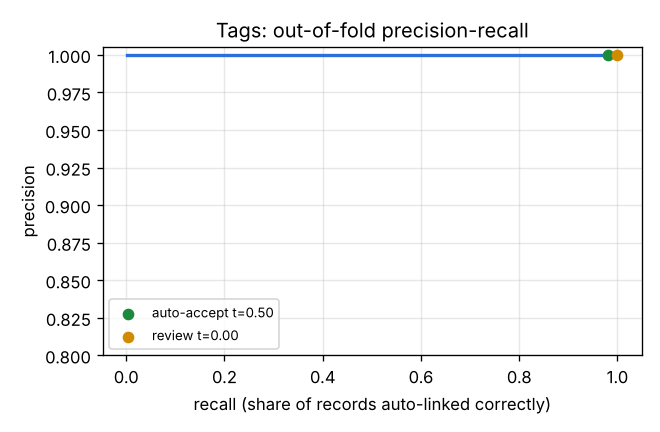
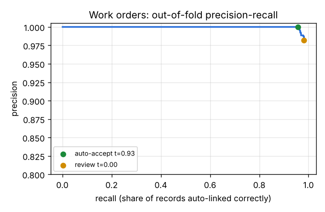

# Part C – ML matcher vs rules-only baseline

Generated by `python -m ddn.match_ml`. ML scores are **out-of-fold**: 5-fold cross-validation grouped by record, so each TRAIN record is predicted by a model that never saw its label.

Sentence-embedding feature: **off** (sentence-transformers or its model not available; feature left empty).

## Summary

| Source | Method | Precision | Recall | F1 | Wrong links |
|---|---|---:|---:|---:|---:|
| Tags | rules only | 1.000 | 0.974 | 0.987 | 0 |
| Tags | ML (top candidate) | 1.000 | 1.000 | 1.000 | 0 |
| Tags | ML auto-accept band only | 1.000 | 0.981 | — | 0 |
| Work orders | rules only | 0.976 | 0.925 | 0.950 | 20 |
| Work orders | ML (top candidate) | 0.982 | 0.982 | 0.982 | 16 |
| Work orders | ML auto-accept band only | 1.000 | 0.957 | — | 0 |

## Tags

- Records: 1,541; candidate pairs: 38,337 (avg 24.9 per record instead of 375)
- **Blocking recall: 1.000** (true asset is among the candidates)
- Thresholds from the precision curve: auto-accept ≥ **0.500**, review ≥ **0.00**, backlog below
- All 1,541 records: auto-accept 1,532, review 9, backlog 0
- ML fixed 14 records the rules got wrong or missed; ML broke 0 records the rules got right

Top features (LightGBM gain): `rule_match`, `rule_conf`, `fuzz_name`, `fuzz_fl`, `line_conflict`, `comp_parent`, `tfidf`, `n_equip_cands`

Threshold trade-off (out-of-fold, labelled records):

| Auto-accept threshold | Auto-linked | Wrong | of which wrong machine | Precision | Share of records auto-linked correctly |
|---:|---:|---:|---:|---:|---:|
| 0.500 (chosen) | 529 | 0 | 0 | 1.0000 | 0.981 |
| 0.700 | 529 | 0 | 0 | 1.0000 | 0.981 |
| 0.800 | 529 | 0 | 0 | 1.0000 | 0.981 |
| 0.900 | 529 | 0 | 0 | 1.0000 | 0.981 |
| 0.950 | 527 | 0 | 0 | 1.0000 | 0.978 |

### Out-of-fold errors (0)

| Record | Confidence | Predicted | Truth | Text |
|---|---:|---|---|---|

## Work orders

- Records: 2,968; candidate pairs: 71,635 (avg 24.1 per record instead of 375)
- **Blocking recall: 0.999** (true asset is among the candidates)
- Thresholds from the precision curve: auto-accept ≥ **0.932**, review ≥ **0.00**, backlog below
- All 2,968 records: auto-accept 2,846, review 122, backlog 0
- ML fixed 51 records the rules got wrong or missed; ML broke 0 records the rules got right

Top features (LightGBM gain): `eqno_match`, `rule_match`, `equip_match`, `comp_conflict`, `eqno_text_agree`, `tfidf`, `line_conflict`, `equip_conflict`

Threshold trade-off (out-of-fold, labelled records):

| Auto-accept threshold | Auto-linked | Wrong | of which wrong machine | Precision | Share of records auto-linked correctly |
|---:|---:|---:|---:|---:|---:|
| 0.500 | 862 | 4 | 3 | 0.9954 | 0.966 |
| 0.700 | 859 | 3 | 2 | 0.9965 | 0.964 |
| 0.800 | 857 | 2 | 1 | 0.9977 | 0.963 |
| 0.900 | 853 | 1 | 1 | 0.9988 | 0.959 |
| 0.932 (chosen) | 850 | 0 | 0 | 1.0000 | 0.957 |
| 0.950 | 848 | 0 | 0 | 1.0000 | 0.955 |

### Out-of-fold errors (16)

| Record | Confidence | Predicted | Truth | Text |
|---|---:|---|---|---|
| `4101050` | 0.93 | `DDN1-BIW-L2-ST06-RB12-WG` | `DDN1-BIW-L1-ST06-RB12` | R12 ka gun nahi chal raha, servo reset kiya  Robot 12 |
| `4100770` | 0.89 | `DDN1-BIW-L2-ST03-RB06-WG` | `DDN1-BIW-L2-ST03-RB06` | L2 ST03 robo ka gun nahi chal raha, servo reset kiya  Robot 06 |
| `4100545` | 0.74 | `DDN1-PRS-PL2-PR2-LUB` | `DDN1-ASM-TR2-ST01-NR04-TC` | TR2 TC controller comm fault, rebooted   |
| `4102240` | 0.62 | `DDN1-BIW-L1-ST01-RB01-WG` | `DDN1-BIW-L2-ST01-RB01-WG` | RB01 gun water leak at cap adaptor   |
| `4102853` | 0.48 | `DDN1-BIW-L2-ST06-RB12-WG` | `DDN1-BIW-L2-ST06-RB12` | L2 RB12 ka gun nahi chal raha, servo reset kiya   |
| `4100468` | 0.46 | `DDN1-BIW-L1-ST07-RB13` | `DDN1-BIW-L2-ST07-RB13` | Rob 13 dress pack cable damaged, replaced  Robot 13 |
| `4102702` | 0.43 | `DDN1-BIW-L2-ST06-RB11-WG` | `DDN1-BIW-L2-ST06-RB12-WG` | weld gun L2 ST06 robo gun cap tip worn, caps changed   |
| `4101187` | 0.35 | `DDN1-BIW-L1-ST04-RB07-WG` | `DDN1-BIW-L3-ST04-RB07-WG` | RB07 gun water leak at cap adaptor   |
| `4100443` | 0.35 | `DDN1-BIW-L1-ST04-RB07` | `DDN1-BIW-L3-ST04-RB07` | R7 dress pack cable damaged, replaced   |
| `4102357` | 0.32 | `DDN1-BIW-L1-ST02-RB03-WG` | `DDN1-BIW-L1-ST02-RB03` | Rob 03 ka gun nahi chal raha, servo reset kiya   |
| `4102921` | 0.15 | `DDN1-PNT-OV2-Z2` | `DDN1-PNT-OV1-Z2` | Z2 oven profile run, within spec   |
| `4101088` | 0.09 | `DDN1-BIW-L3-ST04-RB07` | `DDN1-BIW-L2-ST04-RB07-WG` | Rob 07 gun water leak at cap adaptor   |
| `4101272` | 0.02 | `DDN1-BIW-L3-ST04-RB08` | `DDN1-PNT-ED-P301A` | pump Circulation pump P301-A mechanical seal leaking, seal replaced   |
| `4100279` | 0.00 | `DDN1-ASM-CH1-ST02-NR09-TC` | `DDN1-ASM-TR1-ST02-NR02-TC` | TC controller comm fault, rebooted   |
| `4102637` | 0.00 | `DDN1-PNT-OV1-Z1-BR` | `DDN1-PNT-OV1-Z4-BR` | OV1 BR combustion tuning, O2 checked   |
| `4102282` | 0.00 | `DDN1-BIW-L1-ST01-RB01-WG` | `DDN1-BIW-L1-ST05-RB09-WG` | WG water leak at cap adaptor   |
